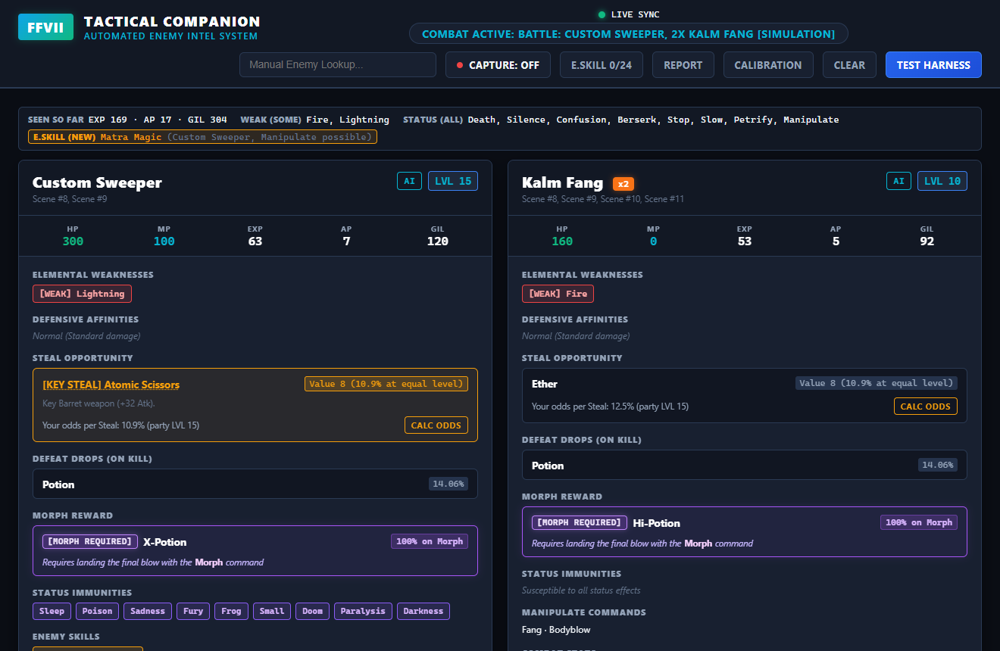
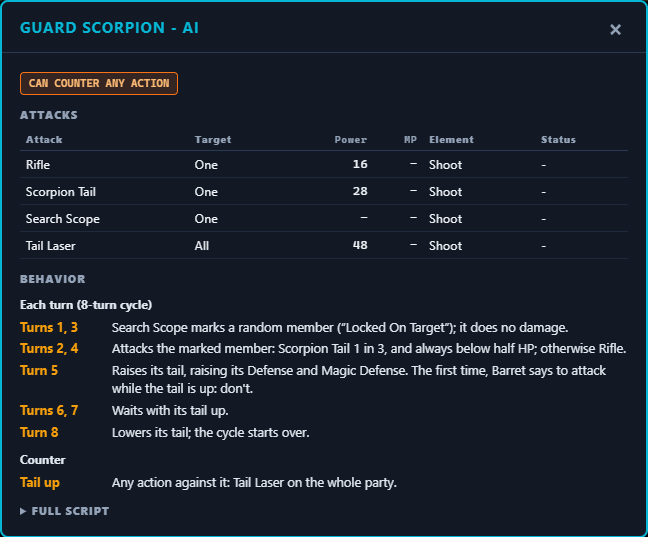

# FFVII Tactical Battle Companion

A live enemy guide for Final Fantasy VII on PC. It reads the battle text on your screen, recognizes the enemies you are fighting, and shows what is worth knowing about them: weaknesses, steal odds, Enemy Skills, and what their AI is going to do. Put it on a second monitor, in a window next to the game, or on your phone or tablet.



It works with the PC release of Final Fantasy VII (1998, the 2012-2013 Steam edition and its re-release), with or without 7th Heaven / FFNx mods. This is a fan project, not affiliated with or endorsed by Square Enix. It only reads what is on screen: it does not modify the game or read its memory, and it sends nothing over the internet. You need your own copy of the game.

## Features

- **Automatic.** Open a command's target menu in battle and the targeted enemy's card appears. No hotkeys, no typing: the text is read with OCR on your PC.
- **Enemy cards.** HP and MP, EXP, AP and Gil, elemental weaknesses, resistances and absorptions, status immunities, every steal item with your odds, drops, morph items, Manipulate commands, Enemy Skills and tactical notes, for all 295 enemies.
- **Battle summary.** For the whole encounter: the elements to use and to avoid, the statuses that work on every enemy, Enemy Skills still to learn, whether you can run, and the EXP, AP and Gil of the formation.
- **Enemy AI.** What each enemy does and when, decoded from the game's own battle scripts: its attacks, what it counters, and a plain-language summary for every boss and for regular enemies with notable behavior.
- **Enemy Skill checklist and steal odds** that follow your party: tick the skills you have, set your party level, and every card shows what is new and your real chance to steal.
- **Formation partners.** From one enemy it predicts who else can be in the fight.
- **Anywhere you look.** A desktop window you can pin on top, or any browser on your phone, tablet or another PC on your home network.
- **Light on the PC.** It runs in Windows Efficiency mode and reads the screen only when the text changes: a recorded session of menus and a battle at 4K averaged 12% of one CPU core ([Benchmarks](docs/BENCHMARKS.md)).

## Download and run

You need Windows 10 or 11 (64-bit). Windows 11 includes the Microsoft Edge WebView2 Runtime the window needs; on Windows 10, install it from Microsoft if the window does not open.

1. Open the [latest release](https://github.com/SnipeAT/FFVII-Battle-Companion/releases/latest) and download `FFVII_Companion-<version>-windows-x64.zip` from its **Assets**.
2. Right-click the downloaded zip, choose **Properties**, tick **Unblock** at the bottom if it is there, and click **OK**. Windows marks downloaded files as coming from the internet; unblocking the zip before extracting it keeps that mark off the extracted files, so Windows asks fewer questions about them.
3. Extract the zip to a folder you can write to, for example `Documents`. Not `Program Files`: the companion saves its settings and logs next to the EXE. Keep the folder path short, under about 150 characters (`C:\Users\<you>\Documents` is fine): some files sit deep inside the `_internal` folder, and in a longer path Windows refuses them.
4. Double-click `FFVII_Companion.exe` in the extracted `FFVII_Companion` folder. If Windows SmartScreen says it protected your PC, click **More info**, then **Run anyway**: the EXE is not code-signed.
5. Start the game and enter a battle: the companion finds the game window and reads the battle text by itself.

**Updating:** delete `FFVII_Companion.exe` and the `_internal` folder, then extract the new release into the same place. The `data`, `logs` and `reports` folders (your settings, profile, logs and reports) stay. **Uninstalling:** delete the folder.

## Using it in battle

1. Run the game borderless or windowed. Exclusive fullscreen can give the companion black frames.
2. Start the companion and move its window to your second monitor, or pin it on top with **PIN**. **CAPTURE: LIVE** glows green while it watches the game; the label shows what it is doing (idle, hunting, settled).
3. In battle, open a command's target menu: the targeted name (`Custom Sweeper`, `Kalm Fang B`) is read and its card appears. A letter after the name raises the enemy count.
4. With one enemy identified, the **Formation Partners** bar lists the enemies that can be in the same fight; click one to add its card.
5. Cards stay up during attacks, summons and Limit Breaks, and clear a few seconds after the victory screen. **CLEAR** empties the battle at once, on every dashboard: the next name the companion reads starts a new encounter, so a cleared enemy comes back only if it is read again.

To look up an enemy outside a battle, type its name in **Manual Enemy Lookup**. **TEST HARNESS** shows sample battles, so you can try the dashboard without the game.

### Battle summary

One strip above the cards, computed from every enemy in the fight:

- **Formation total / seen so far**: EXP, AP and Gil. Once the formation is certain (every formation that fits the enemies seen has the same members), the totals cover the whole formation, including enemies not targeted yet, and **Formation** lists its members.
- **Escape**: "Not possible" for boss and story fights, "Possible" otherwise; left out while the possible formations disagree.
- **Weak (all)**: elements every enemy is weak to. **Weak (some)**: elements some enemies are weak to that no enemy absorbs or ignores, safe to cast on all.
- **Avoid**: elements an enemy absorbs, is immune to or is fully healed by (for example "Fire (no effect on Bomb)").
- **Undead**: enemies that healing magic and items damage (cards show "[UNDEAD]").
- **Status (all)**: ailments no enemy in the fight is immune to.
- **E.Skill (new)**: Enemy Skills of these enemies that you have not ticked yet, highlighted.

### Enemy AI

**AI** next to a card's level opens what the enemy does, decoded from the game's battle data:



- **Can counter / can act on death**: the enemy answers any action, physical attacks or magic with an attack, or acts as it dies (possibly only under a condition: the full script says which).
- **Attacks**: every attack in its list with target, power, MP cost, element and statuses (inflicted, removed or toggled). Enemy Skills are marked NEW or LEARNED, as in the checklist; one the enemy never uses on your party can only be learned through Manipulate.
- **Behavior**: for every boss and for enemies with notable AI, a plain-language summary of when it does what.
- **Full script**: its AI scripts as readable pseudo-code (battle start, its turn, each counter, its death). `VarXXXX` are the enemy's own counters and flags; numbers in brackets are values whose meaning is unknown. It is open from the start when there is no summary.

A boss fought several times (the Turks, Ultimate Weapon) shows the script of the current fight, or each possible one when the enemies on screen fit several.

### Enemy Skills and steal odds

- **E.SKILL** in the header opens the checklist of the 24 Enemy Skills with the enemies that have each one; "(M)" means the skill is also in that enemy's Manipulate list. Tick the skills you have learned, and the cards mark each enemy's skills as NEW or LEARNED.
- **CALC ODDS** on a steal item opens the steal calculator. The party level and Sneak Glove you set there are kept, and every card then shows your odds ("Your odds per Steal: 62.5% (party LVL 40)"). For a second or later item, the figure already counts the earlier items being tried first.
- The checklist, party level and Sneak Glove are saved by the companion, so the desktop window and every other device show the same.

### Reporting a wrong detection

If the companion shows the wrong enemy or count, press **REPORT**. It saves what the companion saw (the capture region at its last reading and right now, with the text it read) into the `reports` folder next to the EXE. Optionally type the enemies that are really on screen ("Devil Ride x2, Kalm Fang") and a note. To help fix it, [open an issue](https://github.com/SnipeAT/FFVII-Battle-Companion/issues) and attach that report's folder as a zip.

### Settings

**CALIBRATION** shows the game window the companion found, the part of it that it reads, and a diagnostic snapshot of what it reads there. The defaults suit the usual game layouts. All settings, command-line flags and file locations: [Configuration](docs/CONFIGURATION.md).

## Phone, tablet or another PC (LAN mode)

1. Close the companion if it is running, then double-click `Launch_LAN_Mode.bat` next to `FFVII_Companion.exe`. It starts the companion in LAN mode and prints your PC's address.
2. On a phone, tablet or PC on the same network, open `http://<YOUR_PC_IP>:59314` in a browser. Find the address with `ipconfig` (IPv4 Address) if needed.
3. Optional: on an iPhone or iPad, tap **Share > Add to Home Screen** in Safari for a full-screen app.
4. The first LAN launch may show a Windows Defender Firewall prompt: allow access on **Private networks**.

After an update of the companion, a dashboard left open on another device reloads itself when it reconnects, so it never runs the old version against the new one.

**Security note:** in LAN mode every device on your network can open the dashboard and use its controls (start and stop capture, calibration, diagnostic snapshots of the capture region). There is no login, so only use LAN mode on a network you trust. Web pages from other sites cannot use the companion: the server sends no cross-origin (CORS) headers, so they cannot read its responses, and it rejects state-changing requests and WebSocket connections whose `Origin` does not match the server. It also answers only requests addressed to an IP address, `localhost` or the PC's name: a web page that points its own domain name at your PC (DNS rebinding) would otherwise count as the same site. A home router does not protect against that, because the page runs in your own browser. `allowed_hosts` in the settings file adds names ([Configuration](docs/CONFIGURATION.md#settings-file-datacalibrationjson)).

## Troubleshooting

- **"Windows protected your PC".** Click **More info**, then **Run anyway**: the EXE is not code-signed.
- **Smart App Control blocked it** (Windows 11 with Smart App Control on). There is no "Run anyway": Smart App Control blocks unsigned programs until Microsoft's cloud service has assessed them, which can take a while after a new release. Try again later, or [run it from source](#run-from-source), which Smart App Control allows.
- **"DLL load failed ... The filename or extension is too long".** The folder path is too long: move the `FFVII_Companion` folder to a shorter path, such as `Documents`.
- **Nothing happens when I start it.** A companion is probably running already (only one runs at a time): look for its window in the taskbar.
- **An error box says the window could not be opened.** On Windows 10, install the Microsoft Edge WebView2 Runtime. The box names the log file with the details (`logs\companion.log` next to the EXE).
- **No cards appear in battle.** Check that **CAPTURE** says **LIVE**, and open **CALIBRATION**: it shows whether the game window was found (**RE-SCAN** looks again) and, with **CAPTURE DIAGNOSTIC TEST SNAPSHOT**, what the companion reads. Run the game borderless or windowed rather than exclusive fullscreen.
- **The wrong enemy or count.** Press **REPORT** (see [Reporting a wrong detection](#reporting-a-wrong-detection)).
- **The phone or tablet cannot open the dashboard.** Start the companion with `Launch_LAN_Mode.bat` (a normal start accepts only this PC), check that both devices are on the same network, and allow the companion through Windows Defender Firewall. If your network is set to Public in Windows, set it to Private, or the firewall blocks the dashboard. If another program uses port 59314, the companion takes the next free port and shows it in its window title.
- **"Cross-origin request rejected"** when opening the dashboard by a name your router gives the PC: open it by IP address, or add the name to `allowed_hosts` ([Configuration](docs/CONFIGURATION.md#settings-file-datacalibrationjson)).

The application log is `logs\companion.log` in the companion's folder.

## Run from source

With [Python 3.14](https://www.python.org/downloads/windows/) installed, in PowerShell:

```powershell
git clone https://github.com/SnipeAT/FFVII-Battle-Companion.git
cd FFVII-Battle-Companion
py -3.14 -m venv .venv
.\.venv\Scripts\python.exe -m pip install -e .
.\.venv\Scripts\pythonw.exe -m ffvii_companion
```

Instead of cloning, you can download **Source code (zip)** from a release and run the commands from `py -3.14` on in its folder. Python is code-signed, so this also works where Smart App Control blocks the EXE. Building your own EXE, the tests and the tools: [Development](docs/DEVELOPMENT.md).

## Documentation

- [Configuration](docs/CONFIGURATION.md): launchers, command-line flags, calibration, every setting, where files are saved.
- [How it works](docs/HOW_IT_WORKS.md): the capture pipeline, sampling phases, low system impact, the game data, the steal formula, how the enemy AI is decoded.
- [Development](docs/DEVELOPMENT.md): setup, tests, tools, building and packaging.
- [Architecture](docs/ARCHITECTURE.md): the codemap, threads and locks, the server's messages, where state lives, the design decisions.
- [Benchmarks](docs/BENCHMARKS.md): the CPU measurements.
- [Changelog](CHANGELOG.md): what changed in each release.

## License

The code and documentation are released under the MIT License (see `LICENSE`), except two third-party parts in `src/ffvii_companion/ppocr/`: the OCR models (the two `.onnx` files: PaddleOCR's PP-OCRv4 in RapidOCR's ONNX conversion) and their post-processing code (`postprocess.py`, adapted from RapidOCR) are under the Apache License 2.0, in `LICENSE.txt` in that folder. FINAL FANTASY VII is a registered trademark of Square Enix; the game's names, data and images remain theirs and are not covered by the MIT License. The enemy and formation data in `src/ffvii_companion/data/` was extracted from the game's files, and the frames in `tests/fixtures/real/` are screenshots of the game. The packaged EXE also contains Python and third-party packages under their own licenses: `THIRD_PARTY_LICENSES.txt` in the release zip lists them, with their license texts where the packages include them.
